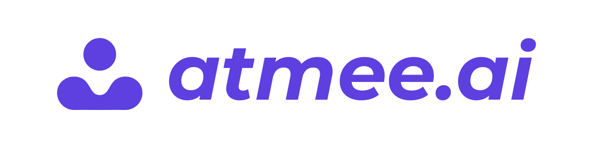

<p align="center">
  <a href="https://www.atmee.ai">
    <picture>
      <source media="(prefers-color-scheme: dark)" srcset="assets/atmee-banner-dark.jpg">
      <source media="(prefers-color-scheme: light)" srcset="assets/atmee-banner-light.png">
      
    </picture>
  </a>
</p>

<h1 align="center">atmee toolkit</h1>

<p align="center">Build talking avatars from your coding agent or terminal, then build apps around them.</p>

<p align="center">
  <a href="https://github.com/Atmanity/atmee-toolkit/releases/latest"></a>
  <a href="LICENSE"></a>
  <a href="https://discord.gg/7nkQFhedKD"></a>
</p>

<p align="center">
  <a href="https://www.atmee.ai">Website</a> ·
  <a href="https://www.atmee.ai/docs">Docs</a> ·
  <a href="#quickstart">Quick start</a> ·
  <a href="#mcp-server-only">MCP</a> ·
  <a href="plugins/atmee/CHANGELOG.md">Changelog</a> ·
  <a href="https://discord.gg/7nkQFhedKD">Discord</a>
</p>

Atmee turns a portrait and a voice sample into a conversational avatar that
talks with people in real time over video. This toolkit gives your coding agent
the skills and the MCP server to create, test and ship those avatars, and gives
your terminal the `atmee` CLI for the same Avatar API.

This repository holds two things:

- **The `atmee` plugin** for Claude Code, Codex and Cursor: five agent skills
  plus the `atmee-avatars` MCP server. The skills also install into any agent
  that the [skills CLI](https://www.npmjs.com/package/skills) supports.
- **The `atmee` CLI**: one Go binary that manages avatars, API keys and
  conversations from a terminal or CI.

Both talk to the same Atmee Avatar API. The plugin signs in as you through
the MCP server; the CLI signs in as you or uses an API key.

## Contents

- [What you can build](#what-you-can-build)
- [Quickstart](#quickstart)
- [Skills](#skills)
- [The atmee CLI](#the-atmee-cli)
- [Requirements](#requirements)
- [Documentation](#documentation)
- [Troubleshooting](#troubleshooting)
- [Updates](#updates)
- [Contributing](#contributing)
- [License](#license)

## What you can build

- **A talking avatar or digital twin** from a name, a portrait and a voice
  sample, with its own persona and knowledge.
- **Live video conversations** in your own website or app: your backend starts
  a session, your page joins the LiveKit room, and the avatar listens and
  answers in its own voice. Avatars can call tools your page defines.
- **Your own agent with an Atmee face**: render an avatar into a LiveKit room
  you control and drive it from your own conversation logic.
- **Generated inputs**: portraits from a description, an enhanced photo, and
  voices designed from a description.

Atmee V2 avatars, and the features built on them (candidate clips, agendas,
video clips), come with Growth and up; below Growth, an invite code unlocks
them. Accounts without Atmee V2 get Atmee V1 avatars; redeem an invite code
with `atmee redeem CODE` or on the Billing page in Creator Studio.

## Quickstart

The quickest route is to let your agent install everything. Paste this into
Claude Code, Codex, Cursor or any other coding agent:

```text
Set up atmee for me by following INSTALL_FOR_AGENTS.md in the GitHub repo Atmanity/atmee-toolkit.
```

The agent detects which agent it is, installs the plugin or the skills, and
stops only for the steps that need you: loading the plugin and signing in on
atmee.ai. It finishes with a check that reports "All set" and your credit
balance. The full procedure is in [INSTALL_FOR_AGENTS.md](INSTALL_FOR_AGENTS.md).

To install by hand, pick your agent below. Then ask your agent to make an
avatar, or run the setup check first (`/atmee:atmee-setup` with the plugin).

### Claude Code

```bash
claude plugin marketplace add Atmanity/atmee-toolkit
claude plugin install atmee@atmee
```

Then, inside Claude Code, run `/reload-plugins --force` to load the plugin,
and `/mcp` > `atmee-avatars` > Authenticate to sign in. Plugins load in local
sessions only, not in cloud sessions.

### Codex

```bash
codex plugin marketplace add https://github.com/Atmanity/atmee-toolkit.git
codex plugin add atmee@atmee
```

Restart Codex, then sign in:

```bash
codex mcp login atmee-avatars
```

### Cursor

In a team, an admin imports `Atmanity/atmee-toolkit` under **Plugins > Import from
Repo** and members install `atmee`. On your own, copy the plugin into Cursor's
local plugins as described in
[INSTALL_FOR_AGENTS.md](INSTALL_FOR_AGENTS.md#2c-cursor). Restart Cursor, then
sign in to `atmee-avatars` under **Settings > MCP**.

### Other agents (skills CLI)

```bash
npx -y skills add Atmanity/atmee-toolkit --skill '*' --agent AGENT_ID --yes --global
```

Replace `AGENT_ID` with your agent's id, for example `gemini-cli`, `github-copilot`, `windsurf`,
`cline` or `opencode`, then start a new session. This route installs the skills
only: the first time you ask for an avatar, `atmee-setup` offers to add the
MCP server to your agent and says which file it changed.

### MCP server only

Any MCP client that supports remote servers with OAuth can use the Avatar
API's MCP server directly:

```text
https://api.atmanity.us/mcp
```

For example, `claude mcp add --transport http atmee-avatars https://api.atmanity.us/mcp`,
or in claude.ai, add it as a custom connector under **Settings > Connectors**.
The first connection signs you in on atmee.ai ("Connect an app to Atmee").
The server creates and updates avatars, takes file uploads, reports your
balance, and generates portraits and voices. Generation calls are paid; the
server's `get_account` tool reports the current prices.

### claude.ai

1. Download a skill from the
   [latest release](https://github.com/Atmanity/atmee-toolkit/releases/latest), for
   example [`create-avatar.zip`](https://github.com/Atmanity/atmee-toolkit/releases/latest/download/create-avatar.zip).
   The others are `build-avatar-app.zip`, `plan-avatar-app.zip`,
   `atmee-product.zip` and `atmee-setup.zip`.
2. Upload it under **Settings > Capabilities > Skills**.
3. Add the MCP server `https://api.atmanity.us/mcp` as a custom connector under
   **Settings > Connectors**.

### CLI

```bash
go install github.com/Atmanity/atmee-toolkit/cli/cmd/atmee@latest
atmee login
atmee balance
```

See [The atmee CLI](#the-atmee-cli) below.

## Skills

| Skill | What it does |
|---|---|
| [`create-avatar`](plugins/atmee/skills/create-avatar/SKILL.md) | Builds an avatar with you: name, photo and voice, see it talk, then give it a character and test it. Also makes short video clips. |
| [`plan-avatar-app`](plugins/atmee/skills/plan-avatar-app/SKILL.md) | Shapes an app idea into a one-page brief by asking in rounds: user, flow, persona, tools, screen, limits, live test. |
| [`build-avatar-app`](plugins/atmee/skills/build-avatar-app/SKILL.md) | Helps you code an app or website around an avatar: backend sessions, joining the call, app state, events, tools, files, agendas. |
| [`atmee-setup`](plugins/atmee/skills/atmee-setup/SKILL.md) | Connects and checks what the others need: the server, sign-in, account, credits, updates and tool prompts. |
| [`atmee-product`](plugins/atmee/skills/atmee-product/SKILL.md) | Tells the agent what Atmee offers and costs (read live from your account), and which path fits an idea. |

With the plugin, the skills are namespaced, for example `/atmee:create-avatar`.

## The atmee CLI

The CLI covers the same Avatar API as the MCP server, for scripts, CI and
backends. Its source is in [`cli/`](cli).

```bash
go install github.com/Atmanity/atmee-toolkit/cli/cmd/atmee@latest
```

The binary lands in `$(go env GOPATH)/bin` (usually `~/go/bin`), which must be
on your `PATH`. Run the same command to upgrade; each release is also tagged
`cli/vX.Y.Z` if you want to pin a version.

Sign in with your browser, or use an API key:

```bash
atmee login                  # browser sign-in; --no-browser prints the link instead
atmee login --api-key        # or save an API key (prompted, hidden)
export ATMEE_API_KEY=...     # or set one for this shell; it wins over a saved sign-in
atmee whoami
```

Create an avatar and talk to it:

```bash
atmee avatars create --name Mira --image ./mira.jpg --voice ./mira.wav \
  --who-prompt "A cheerful urban gardener." --wait
atmee avatars session chat AVATAR_ID --max-seconds 300 --open
```

`create` prints the new avatar's id; use it as `AVATAR_ID`. `--open` joins the
conversation in LiveKit Meet in your browser. Join within 60 seconds of the
start, or the session ends.

| Command | Purpose |
|---|---|
| `atmee login` / `whoami` / `logout` | Sign in, show who the commands act as, sign out |
| `atmee balance` / `account` / `earnings` | Credits, plan and prices, creator earnings |
| `atmee redeem CODE` | Redeem an invite or credit code |
| `atmee keys` | Create, update, rotate and revoke API keys |
| `atmee avatars create` / `list` / `get` / `wait` / `update` / `delete` | Manage avatars |
| `atmee avatars replace-appearance` / `replace-voice` / `replace-knowledge` | Replace an avatar's inputs |
| `atmee avatars candidates` | v2: compare the talking clips built for an avatar and pick one |
| `atmee avatars session chat` / `render` | Start a conversation, or render the avatar into your own LiveKit room |
| `atmee generate portraits` / `enhance` / `voice` / `clip` | Generate portraits, voices and video clips |

Every command has `--help`, and `--json` prints the API's JSON. The full
reference, including every flag, environment variable and the config file
format, is in [docs/cli.md](docs/cli.md).

## Requirements

- **An Atmee account** with credits. Sign up at [atmee.ai](https://www.atmee.ai).
- **Plugin**: a recent Claude Code, Codex or Cursor.
- **Skills CLI**: Node.js 22.20 or newer.
- **CLI**: Go 1.21 or newer (Go downloads the toolchain the CLI needs).
  `atmee avatars candidates sheet` also needs `ffmpeg`.
- **Portrait and voice**: a front-facing photo of one person, head and
  shoulders, lips slightly parted; and 10 to 60 seconds of clear speech by one
  speaker. The skills and `atmee generate` can make either for you.

## Documentation

| Resource | Link |
|---|---|
| Atmee developer docs | [www.atmee.ai/docs](https://www.atmee.ai/docs) |
| MCP server | `https://api.atmanity.us/mcp` |
| Avatar API base URL | `https://api.atmanity.us` |
| CLI reference | [docs/cli.md](docs/cli.md) |
| Agent install guide | [INSTALL_FOR_AGENTS.md](INSTALL_FOR_AGENTS.md) |
| Changelog | [plugins/atmee/CHANGELOG.md](plugins/atmee/CHANGELOG.md) |

## Troubleshooting

| Symptom | Fix |
|---|---|
| Claude Code lists the plugin but no atmee tools | Run `/reload-plugins --force`, or restart Claude Code. `/mcp` shows each server's status. |
| Codex shows no atmee tools after a restart | Run `codex mcp list`. If `atmee-avatars` is missing, add it with `codex mcp add atmee-avatars --url https://api.atmanity.us/mcp`, then `codex mcp login atmee-avatars`. |
| `npx skills` says Node.js is too old | Install Node.js 22.20 or newer, or use the plugin route. |
| `v2_access_required` or `insufficient_v2_credits` | Atmee V2 isn't on this account's plan, or no invite code has unlocked it. Upgrade to Growth and up, redeem an invite code (`atmee redeem CODE`), or make a V1 avatar. |
| `402 insufficient_credits` | Top up in Creator Studio, or raise the API key's spend cap. |
| `409 avatar_not_ready` | The avatar has no ready clip yet. Check with `atmee avatars get AVATAR_ID` or wait with `atmee avatars wait AVATAR_ID`. |
| A build fails at `appearance` | Use a front-facing portrait with the whole head in frame, the face at least a third of it, and the lips slightly parted. |
| A build fails at `voice` | Use 10 to 60 seconds of one person speaking, with no music. |
| "Could not read who this is from the API" | Check `ATMEE_BASE_URL` (unset means production) and run `atmee login` again. |

In any agent, the `atmee-setup` skill runs the same checks and tells you the
one step to take for anything it can't fix.

## Updates

The skills check for a newer release once a session and print the command to
update with. Releases are listed under
[Releases](https://github.com/Atmanity/atmee-toolkit/releases), and the
[changelog](plugins/atmee/CHANGELOG.md) says what changed in each.

## Contributing

This repository is a published copy: each release replaces its contents, so
pull requests here can't be merged. Please
[open an issue](https://github.com/Atmanity/atmee-toolkit/issues) for bugs, questions
and feature requests, and we'll make the change at the source.

## License

[MIT](LICENSE)
